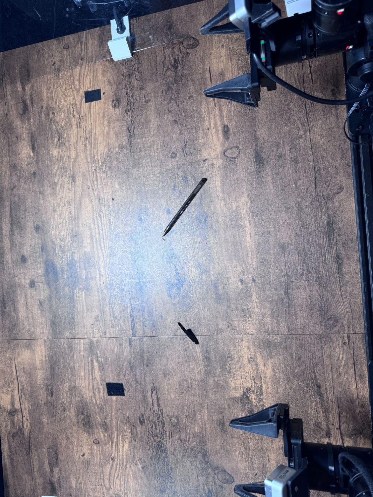

# Cap Pen

Task `robodojo-rc/cap_pen`, version 1, from release 1.0.0. Adapted from
RoboDojo's real-world task [Cap Pen](https://robodojo-benchmark.com/doc/real-tasks/cap-pen/).

## Instruction

What the model is told, word for word:

> Pick up the pen and the pen cap, then put the cap on the pen.

## Setup



There is a pen and a pen cap on the table. The robot needs to pick up both the pen and the cap, align them properly, and put the cap onto the pen. Place everything as in the setup photo (docs/assets/cap_pen-setup.jpg), the team's reference layout.

Between trials: Put every object back where it is in the setup photo (docs/assets/cap_pen-setup.jpg), arms parked.

## Equipment

| Object | Quantity | Product used in the published runs |
|---|--:|---|
| Clear-barrel black ballpoint pen | 1 | [BIC Cristal Xtra Bold black pens, 24 pack](https://www.amazon.com/dp/B004GEC2KC) |
| Matching black pen cap | 1 | [BIC Cristal Xtra Bold black pens, 24 pack](https://www.amazon.com/dp/B004GEC2KC) |

## Rubric

Revision `02bd043f5381`. A trial scores one of these levels. The judge sees the
guidance and every level below, word for word.

```text
Adapted rubric agreed 2026-09-22. Award the highest qualifying score; never add scores. Picked up/gripped and lifted means the held object visibly clears its supporting surface. Lifting and contact milestones retain credit once achieved. Unless explicitly excepted, upright, overlapping, stacked, and contained-object conditions must hold at trial end.
```

| Score | Condition |
|--:|---|
| 0 | Neither pen nor cap picked up. |
| 0.2 | Pen or cap picked up. |
| 0.5 | Pen and cap both held off the surface simultaneously. |
| 0.75 | Pen and cap touch while both are held in the air. No alignment requirement. |
| 1 | Cap successfully placed onto the pen and remains attached at trial end. |
