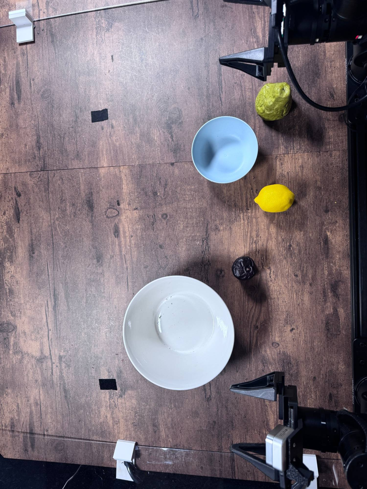

# Pack And Pour Fruit

Task `robodojo-rc/pack_and_pour_fruit`, version 1, from release 1.0.0. Adapted from
RoboDojo's real-world task [Pack And Pour Fruit](https://robodojo-benchmark.com/doc/real-tasks/pack-and-pour-fruit/).

## Instruction

What the model is told, word for word:

> Place all the fruits into the blue bowl, then pour the fruits from the blue bowl into the large white bowl.

## Setup



There are several fruits, a blue bowl, and a large white bowl on the table. The robot needs to pick up all the fruits and place them into the blue bowl, then transfer them by pouring the fruits from the blue bowl into the large white bowl. Place everything as in the setup photo (docs/assets/pack_and_pour_fruit-setup.jpg), the team's reference layout.

Between trials: Put every object back where it is in the setup photo (docs/assets/pack_and_pour_fruit-setup.jpg), arms parked.

## Equipment

| Object | Quantity | Product used in the published runs |
|---|--:|---|
| Small blue bowl | 1 | [MASTERCOOK pastel plastic bowls, 15 oz, 6 pack](https://www.amazon.com/dp/B0GY9S1P3C) |
| Large white receiving bowl (squat truncated cone) | 1 | [Gibson Home Great Essentials white ceramic bowl, 9.4 x 4 inches, 80 oz](https://www.target.com/p/-/A-92374680) |
| Yellow lemon prop | 1 | [ZhangyiHot artificial yellow mini lemons, 6 pack](https://www.amazon.com/dp/B0DFGRFNFS) |
| Green pear prop | 1 | [DisplayFakeFoods Fruit Assortment In Wire Bowl, SKU 5510](https://displayfakefoods.com/fruit-assortment-in-wire-bowl/) |
| Dark plum prop | 1 | [DisplayFakeFoods Fruit Assortment In Wire Bowl, SKU 5510](https://displayfakefoods.com/fruit-assortment-in-wire-bowl/) |

## Rubric

Revision `79e63ce111e0`. A trial scores one of these levels. The judge sees the
guidance and every level below, word for word.

```text
Adapted rubric agreed 2026-09-22. Award the highest qualifying score; never add scores. Picked up/gripped and lifted means the held object visibly clears its supporting surface. Lifting and contact milestones retain credit once achieved. Unless explicitly excepted, upright, overlapping, stacked, and contained-object conditions must hold at trial end. EXCEPTION: Packing scores 0.1, 0.3, and 0.5 retain credit once achieved, even if later spilling or unsuccessful pouring undoes that progress. Count the maximum number simultaneously contained in the small bowl, not cumulative placements. Scores 0.7 through 1.0 require all three fruits to have been packed first; 0.7 requires lifting with all three still inside. Pouring credit requires transfer by pouring, not direct placement, and the poured fruit must remain in the large bowl at trial end. Examples: two packed then spilled = 0.3; three packed then spilled before lifting = 0.5; lifted with all three then all spilled = 0.7.
```

| Score | Condition |
|--:|---|
| 0 | No fruit successfully packed and no higher criterion achieved. |
| 0.1 | One fruit successfully placed into the small bowl. |
| 0.3 | Two fruits successfully contained in the small bowl at the same time. |
| 0.5 | Three fruits successfully contained in the small bowl at the same time. |
| 0.7 | Small bowl lifted clear of its supporting surface with all three fruits inside. |
| 0.8 | One fruit poured from the small bowl into the large bowl and remains there at trial end. |
| 0.9 | Two fruits poured from the small bowl into the large bowl and remain there at trial end. |
| 1 | All three fruits poured from the small bowl into the large bowl and remain there at trial end. |
