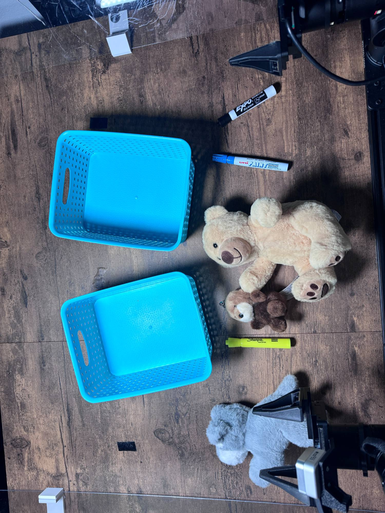

# Sort Objects

Task `robodojo-rc/sort_objects`, version 1, from release 1.0.0. Adapted from
RoboDojo's real-world task [Classify Objects](https://robodojo-benchmark.com/doc/real-tasks/classify-objects/). The judge's rubric keeps RoboDojo's name, Classify Objects.

## Instruction

What the model is told, word for word:

> Classify the two types of objects on the table and place them into the two baskets.

## Setup



There are two categories of objects and two baskets on the table. The robot needs to identify the category of each object, classify them accordingly, and place each type into the correct basket. Place everything as in the setup photo (docs/assets/sort_objects-setup.jpg), the team's reference layout.

Between trials: Put every object back where it is in the setup photo (docs/assets/sort_objects-setup.jpg), arms parked.

## Equipment

| Object | Quantity | Product used in the published runs |
|---|--:|---|
| Turquoise rectangular perforated baskets | 2 | [EudokkyNA blue/white weave baskets, 6 pack](https://www.amazon.com/dp/B08K318YGG) |
| Gray dog plush | 1 | [Skylety plush dogs: Schnauzer, Labrador, Mountain Dog, 3 pack](https://www.amazon.com/dp/B0B5L5M4H8) |
| Small sea otter keychain plush | 1 | [Aurora Mini Selena Sea Otter Palm Pals clip-on plush, brown, 4 inch](https://www.target.com/p/aurora-mini-selena-sea-otter-palm-pals-adorable-clip-on-brown-4/-/A-1012081802) |
| Larger tan teddy-bear plush | 1 | [LotFancy light brown teddy bear, 10 inch](https://www.amazon.com/dp/B08YF1HKRH) |
| Yellow marker/highlighter | 1 | [Sharpie Tank assorted highlighters, 12 pack](https://www.amazon.com/dp/B002BA5WLE) |
| Blue Uni Paint marker | 1 | [Uni Paint PX-20 light blue markers, 2 pack](https://www.amazon.com/dp/B0FCQXHNTW) |
| Black-capped white-barrel VOKART marker | 1 | [VOKART black chisel-tip dry erase markers, 30 pack](https://www.amazon.com/dp/B0H4L7QLT6) |

## Rubric

Revision `b98515b26109`. A trial scores one of these levels. The judge sees the
guidance and every level below, word for word.

```text
Grade the final state of the trial. There are two categories with three objects each and two baskets.
Assign a different category to each basket. If the setup specifies the assignment, use it. Otherwise either assignment is acceptable: use the assignment giving the higher total, with one basket per category. Do not count the same category in both baskets.
Score each basket separately:
0 - Empty, mixed (contains objects from both categories), or contains only objects of the category assigned to the other basket.
0.17 - One object of its assigned category, with no unrelated objects.
0.33 - Two objects of its assigned category, with no unrelated objects.
0.5 - All three objects of its assigned category, with no unrelated objects.
Add the two basket scores and select the matching total below. Mixed baskets always score zero. Maximum total is 1.0. Use the agreed decimal scores as written (for example, 0.17 + 0.17 = 0.34 and 0.33 + 0.33 = 0.66).
```

| Score | Condition |
|--:|---|
| 0 | Both baskets score 0. |
| 0.17 | Basket scores 0.17 + 0, in either order. |
| 0.33 | Basket scores 0.33 + 0, in either order. |
| 0.34 | Basket scores 0.17 + 0.17, for different categories. |
| 0.5 | Basket scores 0.5 + 0, or 0.33 + 0.17, in either order. |
| 0.66 | Basket scores 0.33 + 0.33, for different categories. |
| 0.67 | Basket scores 0.5 + 0.17, in either order. |
| 0.83 | Basket scores 0.5 + 0.33, in either order. |
| 1.0 | Basket scores 0.5 + 0.5: all three objects of each category in separate pure baskets. |
