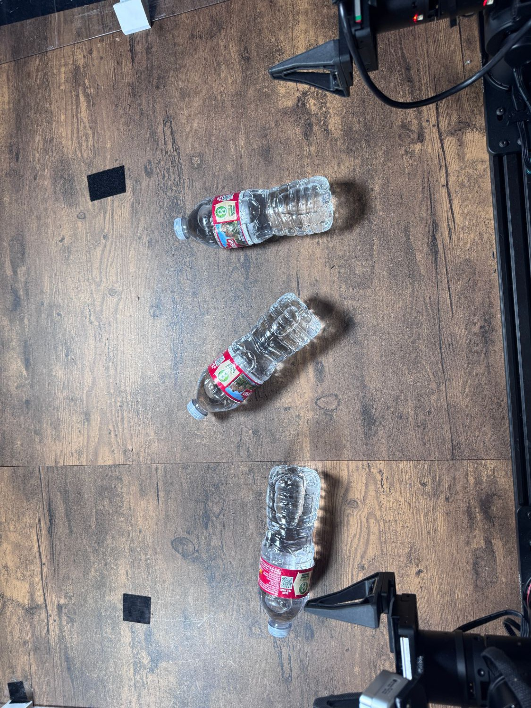

# Stand Up Bottles

Task `robodojo-rc/stand_up_bottles`, version 1, from release 1.0.0. Adapted from
RoboDojo's real-world task [Stand Up Bottles](https://robodojo-benchmark.com/doc/real-tasks/stand-up-bottles/).

## Instruction

What the model is told, word for word:

> Stand all three bottles upright.

## Setup



There is a bottle lying on the table. The robot needs to pick it up and place it upright on the table. Place everything as in the setup photo (docs/assets/stand_up_bottles-setup.jpg), the team's reference layout.

Between trials: Put every object back where it is in the setup photo (docs/assets/stand_up_bottles-setup.jpg), arms parked.

## Equipment

| Object | Quantity | Product used in the published runs |
|---|--:|---|
| Clear Arrowhead water bottles with caps | 3 | [Arrowhead water, 16.9 fl oz, 24 pack](https://www.amazon.com/dp/B000R5NRPI) |

## Rubric

Revision `3ef7c2f54948`. A trial scores one of these levels. The judge sees the
guidance and every level below, word for word.

```text
Award the highest qualifying score; never add scores. Gripped and lifted means the held bottle visibly clears its supporting surface. Tilted at least halfway upright means a bottle's top is raised roughly 45 degrees or more from lying flat while its bottom is in contact with or facing the desk. Held upright means the bottle is vertical on its base while a gripper still holds it. Standing means upright on its base and released (not held by a gripper). Scores 0.1 through 0.85 retain credit once achieved at any point in the trial; knocking a bottle over later does not remove that credit. Scores 0.4 and 0.7 count the maximum number of bottles standing simultaneously at any point. The second-bottle milestone (0.55) only counts while one other bottle is standing at that moment; the third-bottle milestone (0.85) only counts while two other bottles are standing at that moment. Only score 1 requires all three bottles standing at trial end.
```

| Score | Condition |
|--:|---|
| 0 | No bottle gripped and lifted, tilted, or held upright. |
| 0.1 | A bottle gripped and lifted clear of its supporting surface. |
| 0.25 | A bottle tilted at least halfway upright or held upright at some point during the trial. |
| 0.4 | One bottle standing (upright and released) at some point during the trial. |
| 0.55 | One bottle standing and a second bottle tilted at least halfway upright or held upright at the same time. |
| 0.7 | Two bottles standing simultaneously at some point during the trial. |
| 0.85 | Two bottles standing and the third bottle tilted at least halfway upright or held upright at the same time. |
| 1 | All three bottles standing at trial end. |
