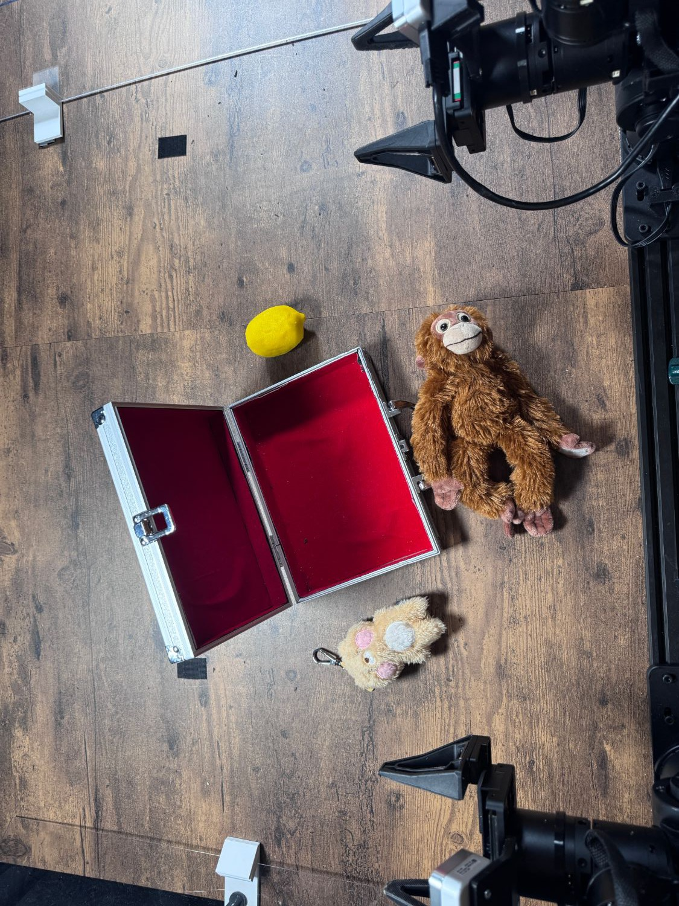

# Store In Safe

Task `robodojo-rc/store_in_safe`, version 1, from release 1.0.0. Adapted from
RoboDojo's real-world task [Store In Safe](https://robodojo-benchmark.com/doc/real-tasks/store-in-safe/).

## Instruction

What the model is told, word for word:

> Place all the objects into the safe, then close the safe.

## Setup



There are multiple objects on the table and a safe nearby. The robot needs to pick up all the objects one by one, place them into the safe, and then close the safe. Place everything as in the setup photo (docs/assets/store_in_safe-setup.jpg), the team's reference layout.

Between trials: Put every object back where it is in the setup photo (docs/assets/store_in_safe-setup.jpg), arms parked.

## Equipment

| Object | Quantity | Product used in the published runs |
|---|--:|---|
| Silver metal hinged case (called safe) | 1 | [Housoutil silver aluminum briefcase with lock](https://www.amazon.com/dp/B0D8TKQN7X) |
| Red lining for case base and lid | 1 | [Mesheshe red self-adhesive felt, 17 × 130 inch](https://www.amazon.com/dp/B09M7JV5YK) |
| Yellow lemon prop | 1 | [ZhangyiHot artificial yellow mini lemons, 6 pack](https://www.amazon.com/dp/B0DFGRFNFS) |
| Light-colored Ryan figurine key holder | 1 | [GIYOMGIYOM KAKA0 Ryan/Choonsik car smart key holder (Ryan Figurine)](https://www.amazon.com/dp/B0CZNLH4ZM) |
| Brown baby monkey plush | 1 | [Tezituor 17.7 inch hanging mother and baby monkey plush set](https://www.amazon.com/dp/B0G8FRC3NV) |

## Rubric

Revision `ff1828950ed0`. A trial scores one of these levels. The judge sees the
guidance and every level below, word for word.

```text
Adapted rubric agreed 2026-09-22. Award the highest qualifying score; never add scores. Picked up/gripped and lifted means the held object visibly clears its supporting surface. Lifting and contact milestones retain credit once achieved. Unless explicitly excepted, upright, overlapping, stacked, and contained-object conditions must hold at trial end. No requirement to move the safe to the center of the table. A lid folded down over the opening counts as closed even when the contents hold it ajar or it does not latch; the robot is not penalized for a lid the objects prop open (rubric v2, 2026-10-23).
```

| Score | Condition |
|--:|---|
| 0 | No objects inside the safe at trial end. |
| 0.25 | One object inside the safe at trial end. |
| 0.5 | Two objects inside the safe at trial end. |
| 0.75 | Three objects inside the safe at trial end. |
| 1 | Three objects inside the safe and the lid folded down over the opening at trial end, even if it rests on the contents or springs partly open when released. |
